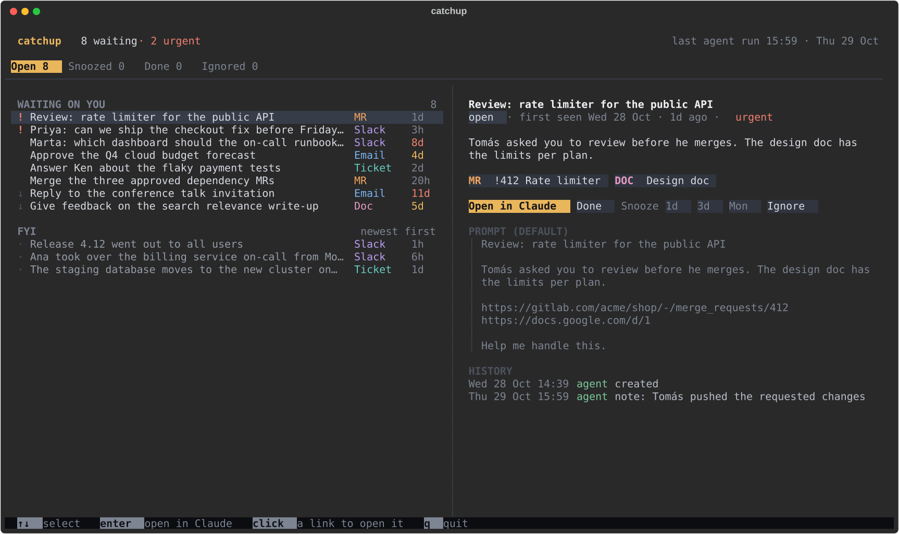

# catchup

Catchup is a local inbox of the things that wait on you: questions to answer, reviews to do, decisions to make. An AI agent fills it. For example, a scheduled Claude Code run reads your chat and email and writes what it finds through the `catchup` CLI. You work through the inbox in a terminal UI: open the links, mark items done, snooze or ignore them, or open an item in a coding agent with a prepared prompt.

The agent decides what counts as an item, what to group, and when to close or reopen one. Catchup stores the items and records every change as an event, so on its next run the agent sees what you did. Catchup is for people who already let an agent read their sources and want one place to see and clear what the agent found.



## Install

Catchup needs Python 3.11 or later and [uv](https://docs.astral.sh/uv/).

```sh
uv tool install git+https://github.com/lukashonke/catchup
```

## Quick start

1. Start the terminal UI in a terminal tab:

   ```sh
   catchup
   ```

   Up and down select an item, left and right switch the state tab. Enter opens the item in Claude, Ctrl+Enter opens its first link, Space marks it done, Backspace ignores it, z snoozes it, u undoes the last change, n adds a note for the agent, / filters the list, s opens the settings, and q quits. Press ? for every key.

   A dot marks the items the agent added or changed since you last looked at them. Inside [herdr](https://herdr.dev), the tab label shows the counts too, such as `catchup 12 · 3 new`.

2. In another terminal, add an item by hand. The UI shows it at once.

   ```sh
   catchup add --kind waiting --title "Review the retry limit change" --priority urgent \
     --link "MR !42=https://git.example.com/acme/billing/-/merge_requests/42"
   ```

3. Connect your agent. Install the agent guide (see below), then let the UI run your agent on a schedule (see [Agent runs](#agent-runs)), or use any other scheduler. Tell the agent to keep the catchup inbox in sync with your sources.

## How an agent uses catchup

The agent guide at [`skills/catchup-inbox/SKILL.md`](skills/catchup-inbox/SKILL.md) tells an agent how to keep the inbox in sync: read the current state first, respect your decisions, when to add, update, reopen or close an item, and how to fill each field. It is an agent skill. To install it for Claude Code, copy the folder into your skills directory:

```sh
cp -r skills/catchup-inbox ~/.claude/skills/
```

Other agents can read the same file as instructions.

A short run looks like this:

```sh
# Read the inbox, including what you did since the last run.
catchup list --state all --kind all --since 14d --json

# A new question waits on you.
catchup add --kind waiting --title "Answer Dana about the retry limit" --body - \
  --link "Thread=https://example.slack.com/archives/C0123/p1700000000" \
  --note "Dana asked in the billing channel" --json <<'EOF'
Dana asks whether the retry limit should be **3 or 5**. She needs the answer before Friday.
EOF

# You replied to another thread, so that item is done.
catchup done 7 --note "You answered in the thread" --json

# Someone posted again in a thread you had closed.
catchup reopen 4 --note "Sam asked a follow-up question" --json

# Something worth knowing that needs no action.
catchup add --kind fyi --title "Release 2.4 shipped" \
  --link "Release notes=https://example.com/releases/2.4" --json
```

Run `catchup --help` and `catchup COMMAND --help` for every option.

## Open in Claude

"Open in Claude" in the UI (or Enter on an item) runs a command that starts a coding agent with the item's prompt. Set the command in `~/.config/catchup/config.toml`, as a list of arguments, and optionally rename the button:

```toml
open_command = ["/path/to/my-opener.sh"]
open_label = "Open in Codex"
```

Catchup runs the command without a shell and passes the item in environment variables:

- `CATCHUP_ID`: the item id.
- `CATCHUP_TITLE`: the title.
- `CATCHUP_PROMPT`: the prompt. If the item has none, catchup sends the title, the body, the link URLs and "Help me handle this."
- `CATCHUP_LINKS`: the link URLs, one per line.

The prompt comes from messages that other people wrote. Never paste these values into a shell string, such as `sh -c "claude '$CATCHUP_PROMPT'"`: a message could then run commands on your machine. Pass them to programs as separate arguments.

If `open_command` is not set and the UI runs inside [herdr](https://herdr.dev) (`HERDR_ENV=1`), catchup uses its bundled herdr opener. It creates a tab in the current workspace, labeled with the item title, in your home directory, and starts Claude Code in it with the prompt. Outside herdr and with no `open_command`, the button tells you how to set it.

### Example: a tmux window

Save this script, make it executable (`chmod +x`), and set `open_command` to its path. Run the catchup UI inside tmux.

```sh
#!/bin/sh
# Open a catchup item in a new tmux window that runs Claude Code with the item's prompt.
# tmux expands #{...} and #(...) in window names and splits commands at a trailing ";".
name=$(printf '%s' "$CATCHUP_TITLE" | tr -d '#;')
exec tmux new-window -n "$name" -c "$HOME" claude -- "$CATCHUP_PROMPT"
```

When `new-window` gets the command as more than one argument, tmux runs it directly, without a shell, so the prompt reaches Claude Code as one argument with nothing expanded. Do not pass the command as one string: tmux then runs it with `sh -c` on the tmux server. The `--` stops Claude Code from reading a prompt that starts with `-` as an option. The new window gets the tmux server's environment, so `claude` must be on the `PATH` that the tmux server started with.

## Agent runs

While the UI is open, it can start your agent on a schedule. Press `s` for the settings, or set it in `~/.config/catchup/config.toml`:

```toml
agent_prompt = """
Use the catchup-inbox skill to sync my inbox with Slack and email.
"""
agent_command = ["claude", "-p", "--permission-mode", "auto"]  # the default
agent_every = "1h"  # the default; 30m, 1h, 4h, ...
```

- With no `agent_prompt`, the UI starts nothing.
- The UI reads the file again when it changes, so the next run uses your edits without a restart.
- The command runs in your home directory, in the background, with the prompt on stdin. It keeps running when you close the UI.
- When the interval has passed since the last start, the UI starts the next run. Press `c` (catch up now) to start one now. If several UIs are open, only one of them starts each run.
- The header shows a spinner while the agent runs, and when the next run is due.
- A run that takes longer than 30 minutes is stopped. Time while the computer sleeps does not count. A failed or stopped run shows in the header until the next run starts.
- Every run is logged to `agent.log` next to the database, with a line where it starts and one where it ends. Settings (`s`) show the end of the log.

The agent reads messages that other people wrote, so a message can try to talk it into doing something else. The default command uses Claude Code's auto mode, which checks each action before it runs. Do not use `--dangerously-skip-permissions` here.

## Todoist

Catchup can show your Todoist tasks in a tab left of the inbox tabs. It reads and changes them through `td`, the [Todoist CLI](https://github.com/Doist/todoist-cli), so catchup never holds your Todoist token. The tab is off by default. Turn it on in the settings (`s`), or in `~/.config/catchup/config.toml`:

```toml
todoist = true
todoist_command = ["td"]  # the default
todoist_filter = "today | overdue"  # the default; any Todoist filter
```

- The tab lists the tasks that match the filter, grouped by project, with the Inbox first. Each row shows the priority in Todoist's colors, the title, the labels, ↻ for a recurring task, and the due date, red when overdue. The details show the description, the project and section, the due date with its recurrence, and the link to the task.
- Space completes the task; a recurring task moves on to its next date. z reschedules it with the snooze picker and keeps its recurrence. Enter opens it in Todoist. `a` opens it in Claude, with a prompt made of the title, the description and the link. R reads the tasks again. Backspace, n and u do nothing on this tab.
- The tab shows the last list at once, also right after the UI starts. It reads a new one in the background when you open the tab, every minute while the tab is shown, and after each action. The line above the list says when the list was updated, or why it was not.
- To set it up, install td with `npm install -g @doist/todoist-cli`. Until td is on the `PATH`, the tab shows how to install it. If td is signed out, press L on the tab: td opens your browser to sign in and keeps the token in the system's credential store.

## Where the data lives

- Database: `$CATCHUP_DB` if set, else `$XDG_DATA_HOME/catchup/catchup.db`, else `~/.local/share/catchup/catchup.db`. It is a SQLite file. Change it only through the `catchup` CLI or the UI.
- Config: `$XDG_CONFIG_HOME/catchup/config.toml`, else `~/.config/catchup/config.toml`. It is optional.
- The last Todoist task list: `todoist.json` next to the database.

To try catchup without touching your inbox, point `CATCHUP_DB` at a scratch file:

```sh
CATCHUP_DB=/tmp/catchup-test.db catchup
```

## Development

```sh
uv sync
uv run pytest
uvx ruff check
uvx ruff format --check
```

[docs/design.md](docs/design.md) explains the design decisions. [GLOSSARY.md](GLOSSARY.md) defines the terms.
